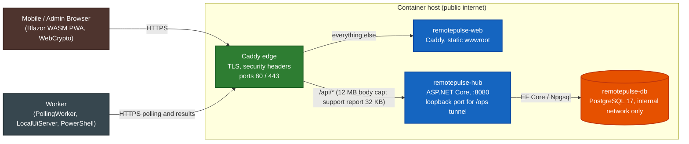

# RemotePulse — Node Communication & Protocol

How the moving pieces — App, the edge proxy (Caddy), Hub Server, PostgreSQL, and the Worker — talk to each other, over what
transport, with what cryptography. For code organization see [architecture.md](architecture.md).

---

## 1. Node Topology

The hosted service (`psrun.inspired.codes`) runs the stack as containers
behind a Caddy edge proxy. A staging host runs the same containers.



- **Caddy** is the single external entry point. It terminates TLS, sets
  `nosniff`, `X-Frame-Options: DENY` and a referrer policy, caps request
  bodies, and answers `/ops` with a 404.
- **The `/ops` operator dashboard** is reachable only through an SSH tunnel to
  the Hub's loopback port, and additionally requires `ADMIN_TOKEN`.
- **Rate limiting is in the Hub, not at the edge** (stock Caddy has none).
  Per client IP: every `/api/*` request 10 req/s with a burst of 20, the
  support report 2 req/min with a burst of 3, pairing 10/min. A rejected
  request gets 429 with `Retry-After`. The settings are `RateLimiting:*` in
  the Hub's configuration.
- **The database** sits on an internal container network with no published
  port.

### Shared rules

- **The Hub never sees plaintext.** Command scripts, pairing
  payloads, and command execution results are encrypted end-to-end between the App and the Worker; the Hub
  only ever handles ciphertext plus signed envelope headers it can verify.
- **PostgreSQL** is the only stateful node. Everything else (Web, Worker,
  Hub itself) is stateless or holds only local cache/key material.

---

## 2. Cryptographic Primitives

Both endpoints (Worker, App) use **ECDSA P-256** for signing
and **ECDH P-256** for key agreement — not RSA, despite what some earlier
design notes in this repo say. The Worker side uses
`System.Security.Cryptography` directly; the App side uses the browser's
native WebCrypto API through JS interop, but the same curve and algorithms.

- **Signing:** ECDSA, SHA-256, IEEE P1363 (fixed-field concatenation)
  signature format — i.e. `SignData(data, HashAlgorithmName.SHA256,
  DSASignatureFormat.IeeeP1363FixedFieldConcatenation)`.
- **Encryption (`HybridCrypto`, wire format v3):** to encrypt a payload for
  a recipient's EC public key, the sender generates a fresh *ephemeral* ECDH
  P-256 keypair, derives a shared secret via `DeriveRawSecretAgreement`,
  runs it through `HKDF-SHA256` (info = `"RemotePulse-v3"`) to get a 256-bit
  AES key, then encrypts with AES-256-GCM passing `rawEphemeralKey` as
  AEAD associated authenticated data (AAD). The output blob is:

  ```
  [65 bytes] ephemeral ECDH public key, uncompressed point (0x04 || X || Y)
  [12 bytes] AES-GCM nonce
  [16 bytes] AES-GCM authentication tag
  [N bytes]  AES-GCM ciphertext
  ```

  Only the holder of the recipient's EC *private* key can re-derive the
  shared secret and decrypt — the sender never needs anything but the
  recipient's public key. Binding the ephemeral public key as AEAD associated
  data ensures an attacker cannot manipulate or substitute the ephemeral key
  on the wire without triggering an AEAD authentication error.

- **Dual-Use Keypair Design Rationale (SEC-8):** Both endpoints deliberately use a
  single NIST P-256 key pair for both ECDSA signing and static ECDH key
  agreement. This minimizes QR payload size, eliminates multi-key synchronization
  overhead, and keeps identity management simple. As established in cryptographic
  literature (e.g., Degabriele, Lehmann, Paterson, Smart, and Strefler, *On the Joint
  Security of Encryption and Signature in Key Agreement Protocols*, CT-RSA 2012), joint
  security of dual-use discrete-log keys holds when primitives are properly domain-separated.
  Cross-protocol interaction attacks are prevented because:
  1. ECDH key agreement uses ephemeral-static derivation where the raw shared point is
     strictly consumed by HKDF with domain-separated info strings (`"RemotePulse-v3"`).
  2. ECDSA signatures strictly sign domain-separated structured payloads (e.g.
     `METHOD:path:id:timestamp:nonce` or `commandId:mode:timeout:ts:nonce:script`),
     which can never collide with or be parsed as raw curve scalar points.

---

## 3. Request Authentication Headers

Every authenticated Hub endpoint (everything except pairing and the health
probe) uses the same four headers:

| Header | Meaning |
| :--- | :--- |
| `X-Client-Id` / `X-App-Id` | The caller's identity (`MachineId` for the Worker, `AppId` for the App) |
| `X-Timestamp` | ISO 8601 UTC, must be within **5 minutes** of server time |
| `X-Nonce` | Random per-request string, checked against `SeenNonces` to block replay |
| `X-Signature` | Base64 ECDSA signature over `"{METHOD}:{path}:{id}:{timestamp}:{nonce}"` (SEC-9), verified against the caller's stored public key |

The server only records the nonce **after** the signature has verified
successfully, so a rejected request can be retried with the same nonce.

The Worker also sends an optional fifth header, `X-Poll-Interval` (its
configured `PollIntervalSeconds`). The Hub stores it and grades health behind
`GET /api/clients/status` in units of that cadence — missed check-ins, not
elapsed seconds — so a Worker deliberately configured to poll slowly isn't
reported as offline while a fast-polling one is still judged promptly.
Successful verification of any Worker request also stamps that machine's
`LastSeenUtc` — the heartbeat the watchdog reads. Stamping happens only on the
verified path, so an unauthenticated caller can't make a dead machine look
alive.

---

## 4. Endpoint Catalog

All routes are under the Hub, proxied at `/api/*` by the edge proxy (Caddy). The table lists the core routes.

| Method & Path | Auth | Body | Purpose |
| :--- | :--- | :--- | :--- |
| `POST /api/pairing/v2` | none (matched by `PairingId`, derived from the QR secret) | `{PairingId, Role, GeneratedAtUtc, MachineId?, PublicKey?, AppId?, AppPublicKey?, SecretSignature?, AppBindTag?}` | Co-presence pairing v2: Worker and App each submit the same `PairingId` (never the secret itself); the Hub matches them and locks the pairing. `AppBindTag` and `SecretSignature` are required for Role=App (see [pairing-v2 spec](specs/pairing-v2-key-binding-spec.md)). `/api/pairing/v1` was removed in 2.0.0 |
| `GET /api/commands/poll` | Worker signature | — | Worker's heartbeat: returns a pending co-presence announcement (`PAIRING:` prefix, delivering the App's public key) or the next queued command, else 204. Optional `?wait=N` long-polls — the Hub holds the request open up to N seconds (capped at 90) and answers the moment work is queued; omitting it keeps the original return-immediately behaviour |
| `GET /api/pairing/status/health` | none | — | Liveness probe for deploy scripts/monitoring, always `{status:"ok", isLocked:false}` |
| `POST /api/commands/queue` | App signature | `{MachineId, EncryptedScript, ExecutionMode, CommandId, TimeoutSeconds}` | App queues an encrypted command for a paired machine |
| `POST /api/commands/results` | Worker signature | `{CommandId, Success, DurationMs, IsEncrypted, EncryptedPayload, RejectionReason}` | Worker reports execution results (encrypted payload if executed, or plaintext rejection reason) |
| `GET /api/commands/results/{commandId}` | App signature | — | App polls for a result |
| `GET /api/clients/status` | App signature | — | Watchdog feed: liveness of every machine this App is paired with, as `[{MachineId, LastSeenUtc, SecondsSinceLastSeen, Health, MissedPolls}]`. `Health` is `Online` / `Degraded` / `Offline` (a string, per the Hub's enum policy) |

---

## 5. Flow: Device Pairing (Co-Presence QR)

The old separate QR-handshake flow (`/api/pairing/handshake` +
`/api/pairing/confirm`, `PendingHandshake`) has been retired — co-presence is
now the only pairing mechanism. Since 2.0.0 it is protocol v2 (key binding);
the full design lives in
[specs/pairing-v2-key-binding-spec.md](specs/pairing-v2-key-binding-spec.md). Summary
(`pid = B64U(HKDF-SHA256(S, "RemotePulse/pairing/v2/id"))`,
`fp = B64U(SHA-256(Worker SPKI))`):

```
[Worker] --LocalUiServer (http://localhost:7923/) shows QR: https://<hub>/pairing/v2#k=<S>&fp=<fp>&ts=<generatedAt>-->
[App] --scans QR, reads k and fp from location.hash (fragment: kept out of URLs and access logs)-->
[Worker] --POST /api/pairing/v2 {PairingId:pid, Role:"Client", MachineId, PublicKey}--> [Hub]
[App]    --POST /api/pairing/v2 {PairingId:pid, Role:"App", AppId, AppPublicKey, SecretSignature, AppBindTag}--> [Hub]
[Hub] --matches both submissions of the same pid, locks Pairing{MachineId, AppId, PairingId, AppBindTag}--> [DB]
[Hub] --returns {clientPublicKey} to the App-->
[App] --rejects unless SHA-256(clientPublicKey) == fp; shows the 6-digit SAS-->
                                                    [Worker] --GET /api/commands/poll (signed)--> [Hub]
                                                    [Hub] --returns "PAIRING:<AppId>:<AppPublicKey>:<pid>:<AppBindTag>"--> [Worker]
                                                    [Worker] --looks up S by pid, verifies AppBindTag,
                                                              saves {AppId, AppPublicKey} to pairing.json,
                                                              shows the 6-digit SAS-->
```

**Trust boundary:** the Hub only ever sees `pid`, never `S`. It can't swap
the Worker key (the App checks it against `fp` from the QR) or the App key
(the Worker checks `AppBindTag`, which needs `S`). Both screens show the same
safety code as a final visual check. The trust anchor is the QR code, i.e.
whoever can see the Worker's screen. Pairings made with v1, before 2.0.0,
trusted the Hub at pairing time (TOFU) and stay valid until the PC is
re-paired.

Once `IsLocked = true`, the pairing is permanent until manually removed from
the database.

## 6. Flow: Command Execution

```
[App] --generate random 256-bit ReplyKey, store non-extractable in IndexedDB pendingCommands-->
[App] --sign scriptText with App private key--> Signature
[App] --hybrid-encrypt {Script, Signature, ReplyKey} with Worker's public key--> EncryptedScript
[App] --POST /api/commands/queue (App-signed headers) {MachineId, EncryptedScript, ...}--> [Hub]
[Hub] --verify App signature, verify App is paired & locked with MachineId--> [DB]
[Hub] --enqueue ServerCommandEntity--> [DB]
                                    [Worker] --GET /api/commands/poll (signed)--> [Hub]
                                    [Hub] --returns next queued command--> [Worker]
                                    [Worker] --HybridCrypto.Decrypt with Worker private key--> {Script, Signature, ReplyKey}
                                    [Worker] --verify Signature against paired App public key, check freshness & replay-->
                                    [Worker] --if validation fails: POST rejection (IsEncrypted=false, RejectionReason="...")--> [Hub]
                                    [Worker] --PowerShellEngine.ExecuteScriptAsync(Script, ExecutionMode)-->
                                    [Worker] --AES-256-GCM encrypt CommandResultPayload with ReplyKey (AAD=CommandId)--> EncryptedPayload
                                    [Worker] --POST /api/commands/results (signed) {CommandId, Success, DurationMs, IsEncrypted:true, EncryptedPayload}--> [Hub]
[Hub] --store CommandResultEntity (no plaintext output columns)--> [DB]
[App] --GET /api/commands/results/{commandId} (App-signed, polling)--> [Hub] --returns result-->
[App] --WebCrypto decrypt EncryptedPayload using stored ReplyKey (AAD=CommandId)--> CommandResultPayload
```

If signature verification, envelope integrity, freshness, or replay check fails at any step, the Worker posts a generic plaintext rejection (`IsEncrypted = false`, `RejectionReason = "EnvelopeUnreadable" | "SignatureInvalid" | "FreshnessExpired" | "ReplayDetected"`). The App strictly refuses any unencrypted command result as an unverified rejection.
